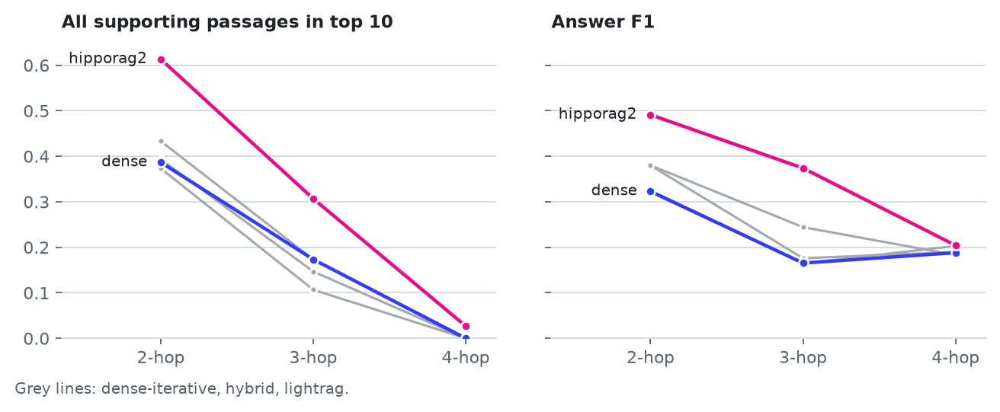

# RI #4: GraphRAG for technical support

This reference implementation (RI) tests whether a graph index beats a plain passage index on questions whose answers connect several documents, and shows how to build a knowledge graph with a fixed schema and a citation for every fact. It is for bootcamp participants who have worked through RI #1's evaluation harness and RI #2's decision framework.

It answers two questions. On 300 MuSiQue questions, does HippoRAG 2 or LightRAG retrieve more of the passages an answer needs than a dense retriever, and at what cost? And how do you build a knowledge graph from ServerFault posts so that every node and edge points back to the words that support it?

## Results on MuSiQue

MuSiQue questions need two, three, or four supporting passages, each linked to the next by an earlier answer. The test draws 300 questions with a fixed seed (150 two-hop, 75 three-hop, 75 four-hop) from the 1,000 in the HippoRAG 2 packaging, and ranks the same 11,656 passages for every arm. One model, `Qwen3_6-35B-A3B`, answers each question from the arm's top five passages with reasoning off. The graph adapters in `aieng.advanced_rag.graphrag.adapters` expose retrieval only: each returns ranked passages, and neither HippoRAG 2's nor LightRAG's own answer generation runs.

The five arms:

- `dense`: `bge-small-en-v1.5` embeddings, cosine ranking.
- `dense-iterative`: the model splits the question into steps, answers each step from dense retrieval, substitutes the answer into the next step, and interleaves the passages found.
- `hipporag2`: the `atlas-rag` implementation of HippoRAG 2, entity-relation stage only. It does not use the HippoRAG 2 paper's extraction prompts, so these figures describe that variant.
- `lightrag`: LightRAG in `mix` mode at its default `top_k` of 40, cut to the same ranking depth.
- `hybrid`: reciprocal rank fusion of `dense` and `hipporag2`.

All-supporting recall is the share of questions whose top-k passages contain every supporting passage. It is the measure that matters here, because an answer to a three-hop question fails when any one hop is missing.

| Arm | All-supporting @5 | All-supporting @10 | Exact match | F1 |
|---|---|---|---|---|
| `dense` | 0.163 | 0.237 | 0.193 | 0.250 |
| `dense-iterative` | 0.197 | 0.233 | 0.220 | 0.297 |
| `hipporag2` | **0.320** | **0.390** | **0.297** | **0.390** |
| `lightrag` | 0.130 | 0.213 | 0.187 | 0.253 |
| `hybrid` | 0.193 | 0.260 | 0.220 | 0.281 |

By hop count, F1 is:

| Arm | 2-hop (150) | 3-hop (75) | 4-hop (75) |
|---|---|---|---|
| `dense` | 0.323 | 0.165 | 0.188 |
| `dense-iterative` | 0.380 | 0.244 | 0.183 |
| `hipporag2` | **0.491** | **0.374** | **0.204** |
| `lightrag` | 0.321 | 0.165 | 0.203 |
| `hybrid` | 0.380 | 0.176 | 0.190 |

All-supporting recall at 10 by hop count is 0.387, 0.173, and 0.000 for `dense`, and 0.613, 0.307, and 0.027 for `hipporag2`. No arm retrieves all four passages for more than two of the 75 four-hop questions.

<picture>
  <source media="(prefers-color-scheme: dark)" srcset="../../docs/assets/ri4-graph-vs-dense-dark.png">
  
</picture>

### Which differences are more than noise

Each graph arm is compared with `dense` on the same questions. The F1 interval is a paired bootstrap, and the all-supporting test is an exact McNemar test on the questions where only one of the two arms has every supporting passage in its top ten.

- `hipporag2` beats `dense`. Across all 300 questions F1 is 0.140 higher (95% interval 0.092 to 0.188). On two-hop questions the gain is 0.168 (0.091 to 0.246) and on three-hop questions 0.209 (0.121 to 0.300). It retrieves every supporting passage on 52 questions where `dense` does not, and `dense` does so on 6 where `hipporag2` does not (p < 0.001). On four-hop questions the F1 difference is 0.016 (-0.061 to 0.091), so the test cannot separate the two.
- `lightrag` does not differ from `dense`. The F1 difference is 0.003 (-0.022 to 0.026), and `dense` has every passage on 11 questions where `lightrag` does not against 4 the other way (p = 0.12).
- `dense-iterative` raises F1 by 0.047 (0.009 to 0.085) but does not retrieve more complete evidence: 16 questions only it completes against 17 only `dense` completes.
- `hybrid` lands between `dense` and `hipporag2`. Its F1 gain over `dense` is 0.031 (0.003 to 0.060), carried by two-hop questions. Fusing in the dense ranking gives up most of what `hipporag2` adds on its own.

The answer to the first question is yes for one graph method and no for the other. HippoRAG 2 as `atlas-rag` implements it beats a dense retriever on two-hop and three-hop questions. LightRAG does not differ from the dense retriever. Neither helps on four-hop questions, where every arm fails to assemble the full chain.

### Cost

Query cost per question, from the model-call meter:

| Arm | Calls | Tokens |
|---|---|---|
| `dense` | 1.00 | 789 |
| `dense-iterative` | 4.53 | 2,149 |
| `hipporag2` | 1.97 | 2,421 |
| `lightrag` | 1.97 | 1,510 |
| `hybrid` | 0.85 | 691 |

The `hybrid` figure undercounts. 346 of its answer calls matched answers cached by earlier arms, so it paid for fewer calls than a cold run would.

Building the indexes costs far more than querying them, and LightRAG uses about 2.5 times the calls and 10 times the tokens of HippoRAG 2:

| Index | Model calls | Tokens | Calls per passage |
|---|---|---|---|
| HippoRAG 2 (`atlas-rag`) | 11,285 | 7.4 million | 0.97 |
| LightRAG | 28,203 | 78.7 million | 2.42 |

The HippoRAG 2 build took 3.9 hours. Wall time is not reported for the LightRAG build, which ran across several resumed sessions. Both ran on `Qwen3_6-35B-A3B`, which the model proxy capped at 90 requests a minute when measured. The ServerFault graph used `Qwen3_8-27B`. The dense index needs no model calls.

### Results on the default model

Every rerun arm answers worse on `gemini-3.5-flash-lite`, the default model for participants, than on `Qwen3_6-35B-A3B`, while its retrieval holds or improves. `hipporag2` falls from F1 0.390 to 0.265, and from 0.377 to 0.273 judged, with the same all-supporting recall at 10 (0.397 against 0.390). `dense-iterative` has every supporting passage in its top five for 0.307 of questions against 0.197 on Qwen, because Gemini's step questions find more of the chain, and still answers worse (F1 0.245 against 0.297). The largest drop is on three-hop questions, where `hipporag2` falls from F1 0.374 to 0.147. The order of the arms holds: on Gemini `hipporag2` beats `dense` by 0.095 F1 (95% interval 0.056 to 0.135), against 0.140 on Qwen.

The rerun uses the indexes built with `Qwen3_6-35B-A3B` and the same 300 questions; only the model that answers, and that writes `dense-iterative`'s step questions and `hipporag2`'s query entities, changes. The shared judge `gemini-3.8-flash` graded both models' answers, given the question, the reference answer, and the five passages the answer came from. `lightrag` and `hybrid` were not rerun. `outputs/musique_graph_test_gemini.json` holds the rerun, labelled a paid-model rerun in its `produced_by` block, and `outputs/musique_graph_test.json` holds the judged column of the on-prem rows.

| Arm | Model | All-supporting @5 | All-supporting @10 | Exact match | F1 | Judged | Calls | Tokens |
|---|---|---|---|---|---|---|---|---|
| `dense` | `Qwen3_6-35B-A3B` | 0.163 | 0.237 | 0.193 | 0.250 | 0.243 | 1.00 | 789 |
| `dense` | `gemini-3.5-flash-lite` | 0.163 | 0.237 | 0.140 | 0.170 | 0.180 | 0.98 | 748 |
| `dense-iterative` | `Qwen3_6-35B-A3B` | 0.197 | 0.233 | 0.220 | 0.297 | 0.283 | 4.53 | 2,149 |
| `dense-iterative` | `gemini-3.5-flash-lite` | 0.307 | 0.393 | 0.190 | 0.245 | 0.243 | 4.54 | 2,083 |
| `hipporag2` | `Qwen3_6-35B-A3B` | 0.320 | 0.390 | 0.297 | 0.390 | 0.377 | 1.97 | 2,421 |
| `hipporag2` | `gemini-3.5-flash-lite` | 0.330 | 0.397 | 0.207 | 0.265 | 0.273 | 1.91 | 2,227 |

These are single runs with no repeats, scoped to one answering model, the Qwen-built indexes, and this question set. The same Gemini model gains as an agent: RI #5's `C0`, an agent with this dense search, rises from F1 0.440 on Qwen to 0.554 on Gemini.

### Gemini on Qwen's passages

On these 300 questions the drop on `gemini-3.5-flash-lite` is abstention: given the same five passages, Gemini replies "unknown" far more often than `Qwen3_6-35B-A3B`, and the answers it does give score as well as Qwen's. A follow-up run handed Gemini, for every question and arm, the exact five passages Qwen answered from (`--rankings-from outputs/musique_graph_test.json`). `dense` needed no swap, because its ranking does not depend on the model and the two runs already read identical passages.

| Arm | Reader | Prompt | Answers "unknown" | F1 | Judged |
|---|---|---|---:|---:|---:|
| `dense` | `Qwen3_6-35B-A3B` | standard | 0.550 | 0.250 | 0.243 |
| `dense` | `gemini-3.5-flash-lite` | standard | 0.760 | 0.170 | 0.173 |
| `dense` | `Qwen3_6-35B-A3B` | best guess | 0.000 | 0.338 | - |
| `dense` | `gemini-3.5-flash-lite` | best guess | 0.000 | 0.291 | 0.277 |
| `dense-iterative` | `Qwen3_6-35B-A3B` | standard | 0.480 | 0.297 | 0.283 |
| `dense-iterative` | `gemini-3.5-flash-lite` | standard | 0.710 | 0.211 | 0.217 |
| `dense-iterative` | `Qwen3_6-35B-A3B` | best guess | 0.000 | 0.377 | - |
| `dense-iterative` | `gemini-3.5-flash-lite` | best guess | 0.000 | 0.342 | 0.327 |
| `hipporag2` | `Qwen3_6-35B-A3B` | standard | 0.380 | 0.390 | 0.377 |
| `hipporag2` | `gemini-3.5-flash-lite` | standard | 0.647 | 0.236 | 0.247 |
| `hipporag2` | `Qwen3_6-35B-A3B` | best guess | 0.000 | 0.478 | - |
| `hipporag2` | `gemini-3.5-flash-lite` | best guess | 0.000 | 0.425 | 0.417 |

With the standard prompt, Gemini on Qwen's passages scores F1 0.211 on `dense-iterative` and 0.236 on `hipporag2`, lower than on its own retrieval (0.245 and 0.265), so retrieval was never the cause. On the questions both models answer, F1 is the same within 0.03 (`hipporag2` 0.700 against 0.674 over 103 questions; `dense` 0.754 against 0.724 over 69). The gap is the questions Gemini declines and Qwen answers: 66, 72, and 83 for the three arms. Qwen answers most of them from incomplete evidence: every supporting passage is in the five for only 8, 6, and 18 of them, yet Qwen scores F1 0.35 to 0.54 there. Gemini also declines 26 of the 96 `hipporag2` questions whose five passages hold every supporting passage, against 9 for Qwen.

The surprise is the prompt. The answering instruction offers "unknown" when the passages do not contain the answer. A second instruction, "best guess" (`--answer-prompt best-guess`), asks for the most likely answer the passages support instead. It raises F1 on every row for both models: by 0.12 to 0.19 on Gemini and by 0.08 to 0.09 on Qwen, and Gemini's judged accuracy rises with it (`hipporag2` 0.247 to 0.417). On Gemini with this prompt the three pipelines beat Qwen's standard rows. On MuSiQue, where every question has an answer, the abstention option costs more than it saves. The trade-off belongs to the task: on a set with unanswerable questions, as RI #5's near-miss nulls are, declining is the right answer. The next section measures what dropping the option costs on such questions.

`outputs/musique_reader_swap_gemini.json`, `outputs/musique_reader_swap_best_guess_gemini.json`, and `outputs/musique_reader_swap_best_guess_onprem.json` hold the runs. Qwen's standard abstention shares come from its cached reference answers. The Gemini runs cost about $2, answering and judging. The commands, with `<paid_responses.sqlite>` a response cache separate from the on-prem one:

```bash
ADVANCED_RAG_SPEND_LIMIT_USD=4 python run_musique_test.py --family google \
  --arms dense dense-iterative hipporag2 --rankings-from outputs/musique_graph_test.json \
  --judge --judge-model gemini-3.8-flash --cache <paid_responses.sqlite> \
  --out outputs/musique_reader_swap_gemini.json
```

```bash
ADVANCED_RAG_SPEND_LIMIT_USD=3 python run_musique_test.py --family google \
  --arms dense dense-iterative hipporag2 --rankings-from outputs/musique_graph_test.json \
  --answer-prompt best-guess --judge --judge-model gemini-3.8-flash \
  --cache <paid_responses.sqlite> --out outputs/musique_reader_swap_best_guess_gemini.json
```

### Cost of dropping "unknown" on unanswerable questions

The best-guess prompt answers every question, including the ones whose passages hold no answer. On the 300 test questions made unanswerable by withholding their supporting passages, it gives an answer to all 300, and 82 to 89 of every 100 are not the reference answer. The standard prompt on `gemini-3.5-flash-lite` answers 5 of every 100.

The local MuSiQue copy is the HippoRAG 2 packaging, which holds only answerable questions. MuSiQue's own unanswerable contrast questions live in the release archive with a 20-paragraph context each, outside this corpus. This test builds unanswerable questions the same way, by removing supporting paragraphs, but from what the reader sees: `--withhold supporting` drops every supporting passage from the stored top 10 and the reader answers from the next five, which stay on the question's topic; `--withhold final` drops only the passage that states the final answer and keeps the bridge passages. Both readers answer the same 300 questions from the `dense` and `hipporag2` rankings in `outputs/musique_graph_test.json`, with three prompts: standard, best guess, and `flagged`, which always answers but appends "(unsure)" when the passages do not state the answer directly. A caller can show a flagged answer or hide it, so it gives two policies.

In the table, F1 counts a declined or hidden answer as 0. The two right-hand columns give answers shown per 100 unanswerable questions, and in parentheses how many of those are not the reference answer (token F1 below 0.5).

| Arm | Reader | Policy | F1, answerable | Share shown, answerable | Shown, all supporting withheld | Shown, final passage withheld |
|---|---|---|---:|---:|---:|---:|
| `hipporag2` | `gemini-3.5-flash-lite` | standard | 0.253 | 0.36 | 5 (3) | 17 (12) |
| `hipporag2` | `gemini-3.5-flash-lite` | best guess | 0.433 | 1.00 | 100 (85) | 100 (79) |
| `hipporag2` | `gemini-3.5-flash-lite` | flagged, show all | 0.433 | 0.96 | 96 (79) | 94 (73) |
| `hipporag2` | `gemini-3.5-flash-lite` | flagged, hide unsure | 0.338 | 0.54 | 19 (14) | 29 (21) |
| `hipporag2` | `Qwen3_6-35B-A3B` | standard | 0.389 | 0.62 | 25 (17) | 39 (25) |
| `hipporag2` | `Qwen3_6-35B-A3B` | best guess | 0.476 | 1.00 | 100 (82) | 100 (77) |
| `hipporag2` | `Qwen3_6-35B-A3B` | flagged, show all | 0.458 | 0.95 | 86 (68) | 90 (67) |
| `hipporag2` | `Qwen3_6-35B-A3B` | flagged, hide unsure | 0.412 | 0.74 | 46 (37) | 59 (42) |
| `dense` | `gemini-3.5-flash-lite` | standard | 0.173 | 0.24 | 5 (3) | 12 (6) |
| `dense` | `gemini-3.5-flash-lite` | best guess | 0.305 | 1.00 | 100 (89) | 100 (83) |
| `dense` | `gemini-3.5-flash-lite` | flagged, show all | 0.312 | 0.97 | 96 (82) | 97 (81) |
| `dense` | `gemini-3.5-flash-lite` | flagged, hide unsure | 0.224 | 0.36 | 13 (9) | 20 (13) |
| `dense` | `Qwen3_6-35B-A3B` | standard | 0.255 | 0.45 | 19 (13) | 29 (19) |
| `dense` | `Qwen3_6-35B-A3B` | best guess | 0.340 | 1.00 | 100 (85) | 100 (80) |
| `dense` | `Qwen3_6-35B-A3B` | flagged, show all | 0.331 | 0.88 | 84 (68) | 85 (64) |
| `dense` | `Qwen3_6-35B-A3B` | flagged, hide unsure | 0.275 | 0.61 | 46 (37) | 52 (38) |

Read a row pair as an exchange rate. On `hipporag2` with Gemini, best guess buys 0.180 F1 on answerable questions for 95 more answers per 100 unanswerable ones, about 82 of them wrong. Flagged with unsure answers hidden buys 0.085 F1 for 14 more. Qwen's standard prompt already answers 19 to 25 of every 100 questions with no supporting passage, so it has less abstention to lose. Withholding only the final passage makes the standard prompt and the hide-unsure policy show more answers, because the bridge passages name the right entities.

Some of these questions are not unanswerable to the reader. With no passages at all (`--withhold everything`, `dense` arm), best guess scores F1 0.263 on Gemini and gives the reference answer on 81 of the 300 questions; Qwen scores 0.198 and gets 65. On-topic passages without the answer lower that: with every supporting passage withheld, Gemini's best guess scores 0.111 on `dense` and 0.146 on `hipporag2`. Recall from memory also accounts for part of the best-guess lift on answerable questions. On Gemini `hipporag2`, best guess raises the questions answered with F1 of 0.5 or more from 76 to 134, and 28 of the 58 added are questions it answers with no passages. On Qwen the rise is 125 to 152, and 6 of the 27 are. MuSiQue is built from Wikipedia, so memory helps here; it cannot help on documents the model never saw. With no passages, Gemini's standard prompt declines 99% of questions and Qwen's 72%.

These are single runs with no repeats, scored by token F1 without the judge, on the 300 MuSiQue test questions, the Qwen-built indexes' rankings, and unanswerable questions built by withholding passages. Rerunning the standard and best-guess prompts on the full rankings moved F1 by up to 0.017 from the table in the previous section (Gemini `hipporag2` standard 0.236 to 0.253), from run-to-run variation at temperature 0. Best guess would be the safer default only if a task's unanswerable share is near zero, or if a check after the answer catches unsupported ones. The cheapest test of the second is to add a grounding check to the best-guess answers on the withheld runs and count how many of the 300 it stops.

`outputs/musique_abstention_cost_gemini.json` and `outputs/musique_abstention_cost_onprem.json` hold the summaries and the per-question outcomes (declined, flagged, or answered) with their F1, and no question or answer text. The Gemini runs cost about $1.00 by the spend guard's estimate. One of the twelve runs per reader, with `<paid_responses.sqlite>` a response cache separate from the on-prem one and `<run_dir>` a scratch directory:

```bash
ADVANCED_RAG_SPEND_LIMIT_USD=1 python run_musique_test.py --family google \
  --arms dense hipporag2 --rankings-from outputs/musique_graph_test.json \
  --withhold supporting --answer-prompt flagged --cache <paid_responses.sqlite> \
  --out <run_dir>/gemini_flagged_supporting.json
```

The other runs vary `--answer-prompt` over `standard`, `best-guess`, and `flagged`, and `--withhold` over `none`, `supporting`, and `final`, plus `everything` on `--arms dense`. The combined file comes from:

```bash
python musique_abstention.py --runs <run_dir>/gemini --out outputs/musique_abstention_cost_gemini.json
```

### Rerun on the default model

The rerun command, with `<paid_responses.sqlite>` a response cache file separate from the on-prem one:

```bash
ADVANCED_RAG_SPEND_LIMIT_USD=10 python run_musique_test.py --family google \
  --arms dense dense-iterative hipporag2 --judge --judge-model gemini-3.8-flash \
  --cache <paid_responses.sqlite> --out outputs/musique_graph_test_gemini.json
```

The runner restores only the indexes the selected arms read.

### Limits of the test

- 300 questions give wide intervals for the three-hop and four-hop groups, 75 questions each.
- One model reads the evidence for every arm. A different reader changes the absolute scores, so compare arms within this table and not against published numbers.
- `hipporag2` is the `atlas-rag` variant. A build with the HippoRAG 2 authors' extraction prompts is not tested here.
- LightRAG ran in `mix` mode with its defaults and no reranker configured.
- The LightRAG figures come from the repaired index. The first published index lacked the chunks, vectors, or graph links of 26 passages that an interrupted build had marked processed. None of them supports a question in this test. Re-indexing them changed the ranking for 22 questions and moved LightRAG's exact match from 0.190 to 0.187 and its F1 from 0.256 to 0.253; its retrieval figures did not change.

## Knowledge graph from ServerFault

`build_serverfault_graph.py` extracts a graph directly from 9,999 ServerFault posts with two model calls each, under a schema of seven entity types and seven relation types. A mapping table folds the model's labels onto the schema after each call, and a relation with an unmapped type or a dangling endpoint is dropped. Every mention records the post, the section (title, question, or accepted answer), the block, and the character span of the quoted words. 94.2% of the 229,623 mentions resolve to a span.

The build produced 63,436 entities and 86,644 relations in 20,077 calls and 26.1 million tokens over 8.1 hours. `01_construction_provenance_store.ipynb` walks through the schema, a post's citations, validation, and the cost, and it reads the committed results in `outputs/` unless you set `RUN_EXPENSIVE = True`.

Dense retrieval over a plain chunk index puts the answer in the top 10 for 99.2% of the questions on the ServerFault support corpus, which leaves no retrieval headroom to measure. This graph is judged on its construction and its citations.

## Graph maintenance

`02_graph_maintenance.ipynb` demonstrates incremental updates to the ServerFault graph as posts change: retraction of a post by provenance, re-extraction of revised posts from the dump's post history, drift when a second model re-extracts unchanged posts, name-folding deduplication against a hand-labelled sample, and a gate that checks a changed graph before it replaces the one in service. It also deletes a passage, edits a passage, and merges two entities in a copy of the five-passage LightRAG MuSiQue index, and lists what atlas-rag exposes for changing a HippoRAG 2 index. `graph_maintenance.py` runs each measurement and writes one JSON file to `outputs/maintenance/`, which the notebook reads unless you set `RUN_EXPENSIVE = True`. The MuSiQue indexes that `run_musique_test.py` scores are built once from the full corpus and never updated.

## Datasets

- MuSiQue, in the HippoRAG 2 packaging (`osunlp/HippoRAG_2`, pinned revision in `CORPUS.md`). The MuSiQue repository licenses it CC BY 4.0. The packaging's dataset card states no licence.
- ServerFault, from the Internet Archive `stackexchange` dump, whose download is checked by MD5. Posts are CC BY-SA at the version each post records, which spans 2.5, 3.0, and 4.0.

`CORPUS.md` records sources, pins, and licences. `outputs/ATTRIBUTION.md` covers the committed results.

## Files

- `build_indexes.py` builds the HippoRAG 2 and LightRAG indexes and stores each in the artifact cache.
- `run_musique_test.py` restores the indexes the selected arms read and runs them, writing `outputs/musique_graph_test.json`. `--family`, `--cache`, and `--judge` rerun the arms on another model with its own response cache and judge the answers.
- `musique_arms.py` and `musique_report.py` hold the arms and the report.
- `musique_abstention.py` combines the abstention-cost runs (`--withhold`, `--answer-prompt`) into `outputs/musique_abstention_cost_*.json`.
- `build_serverfault_graph.py` builds the ServerFault graph.
- `01_construction_provenance_store.ipynb` covers the graph's construction and citations.
- `graph_maintenance.py` measures graph maintenance on the ServerFault graph.
- `02_graph_maintenance.ipynb` covers graph maintenance.

## Prerequisites

- Python and the bootcamp environment (see `docs/`).
- Familiarity with RI #1's evaluation harness and RI #2's decision framework.
