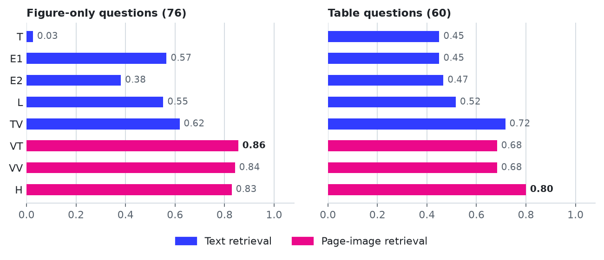

# Special topic: parse, enrich, or embed the page

This special topic compares ways of answering questions whose evidence is a chart or a table
in a PDF: parsing the page to text, enriching the parse with a vision model's descriptions
(the harness approach), and retrieving page images with ColModernVBERT. It is for teams whose
documents carry figures, schematics, scanned pages, or dense tables, and it ends in a decision
guide and a notebook that runs the first test on a team's own pages.

## Notebooks

- `01_parse_enrich_or_embed.ipynb` compares eight arms and four oracle rows on 1,000
  FinanceBench filing pages with one reader model, splits each arm's loss into retrieval loss
  and reading loss, and prices each approach under a scenario.
- `02_your_own_pages.ipynb` runs the figure-only test and three arms (text, enriched text, and
  page images) on up to 20 of your pages and 10 of your questions, printing each step's cost
  before it runs. It ships with a six-page demonstration document, `demo/larkspur_freight_review.pdf`,
  which `vdocs.own_pages.write_demo_pdf` draws from scratch, so its content is not from any
  real company.
- `03_replicate_carried_claims.ipynb` measures the three observations notebook 01 states as
  hypotheses: whether OCR on born-digital pages loses to the text layer, whether
  picture descriptions state more unsupported content on small crops, and whether OCR misses the
  relations a diagram draws while a vision-model description recovers them. It reads
  `outputs/replication.json` and `outputs/diagrams.json` and calls no model;
  `replicate_claims.py` and `diagram_claim.py` rebuild them.

Both notebooks follow the repository pattern: `RUN_EXPENSIVE = False` and
`MODELS = choose_models(show=True)` in the first code cell, every model step through
`load_or_run`, and `spend.report()` last. With the flag off they read the reference run. With
it on they run your models on a 60-question stratified subset (notebook 01) or on your pages
(notebook 02).

## Arms

| Row | Retrieval | Reader input | Family |
| --- | --- | --- | --- |
| `T` | `bge-small-en-v1.5` over Docling text, table-aware chunks | Top 5 chunks | Text-only parse |
| `E1` | As `T`, with generic picture descriptions inlined | Top 5 chunks | Parse plus enrichment |
| `E2` | As `T`, with domain-prompted descriptions and table summaries inlined | Top 5 chunks | Parse plus enrichment |
| `L` | ColBERT over `E2`'s chunks | Top 5 chunks | Late-interaction control |
| `VT` | ColModernVBERT page images | Top 3 pages' `E2` text | Page retrieval, text reader |
| `VV` | ColModernVBERT page images | Top 3 page images | Page retrieval, image reader |
| `TV` | `E2`'s ranking, as pages | Top 3 page images | Text retrieval, image reader |
| `H` | Reciprocal rank fusion of `E2` and `VV` | Top 3 pages, image and `E2` text | Hybrid |
| `O-text`, `O-enriched`, `O-image`, `O-both` | The gold page | As named | Oracles |

## Results of the reference run

One run, no repeats, one reader (`Qwen3_8-27B`), 1,000 pages, and 246 questions: 76
figure-only, 44 duplicated (the chart's values are also in the page text), 60 table, 40
FinanceBench controls, and 26 near-miss nulls. `outputs/results.json` holds every figure.

- Text retrieval with Docling's text answers 2 of 76 figure-only questions. Page-image
  retrieval answers 64 with an image reader (`VV`) and 65 with the pages' enriched text as
  the reader's input (`VT`).
- The generic picture prompt (`E1`) beats the domain prompt (`E2`) on figure-only questions,
  43 to 29, and the loss is retrieval: with the gold page, `E2`'s text answers 72 of 76. A
  follow-up (`outputs/followup_e2_pictures_only.json`) puts about 6 points of the retrieval
  gap on the table summaries and the rest on the descriptions' markdown form.
- On tables, fused retrieval (`H`) answers 0.80 against `T`'s 0.45, and every text reader
  answers the gold table correctly, so the gap is retrieval.
- A paid reader costs about $0.16 per 1,000 questions for a text row and $0.35 for a page
  row on `claude-haiku-5-5` or `gpt-6-luna`, at list price on the measured tokens.

- Forced OCR on 300 born-digital pages (rendered at 216 dpi) keeps 95% of the text layer's
  words and 98% of its numbers, and arm `T` answers 102 of 246 questions against 108 from the
  text layer (p = 0.18). The domain prompt halves the share of descriptions with a claim the
  crop does not support (0.15 against 0.31), and small crops show no more unsupported content
  than large ones. Notebook 03 has the detail.
- On 30 diagram slides from ViDoRe v3 physics (265 drawn relations listed by `claude-sonnet-5-5`),
  the text layer states 2% of the relations and RapidOCR 2%. `gemini-3.5-flash-lite` states 55%
  with a prompt that asks for arrows and connections, and 18% with the generic prompt `E1` uses;
  `claude-haiku-5-5` states 64% with the relations prompt. With the drawing painted out and the
  labels kept, the relations prompt states 19%. Adding those descriptions to the text layer lifts
  page recall at 5 for the 34 diagram queries from 0.44 to 0.62 with `bge-small-en-v1.5` and
  English queries, and from 0.53 to 0.56 with BM25 and the French queries.

<picture>
  <source media="(prefers-color-scheme: dark)" srcset="../../../docs/assets/visual-documents-dark.png">
  
</picture>

The question set was built and checked by models, and a figure question survived only if a
model read it off the page image, so the oracle rows on figures sit high by construction. A
hand check of 10 sampled questions found every reference answer correct.

## Rebuild the replication results

`replicate_claims.py` parses the pages again under each OCR condition on the CPU, ranks and
answers with the reference models, and judges picture descriptions with `gemini-3.8-flash`,
which is the only paid step (about $0.85 in the reference run):

```bash
ADVANCED_RAG_SPEND_LIMIT_USD=3 python replicate_claims.py parse fidelity retrieval answers crops report
```

Each stage resumes: parsed folders, response caches, and stage results stay in the local cache.

`diagram_claim.py` runs the diagram test. It reads a local snapshot of `vidore/vidore_v3_physics`
(it downloads one into the artifact cache when `--data` is omitted), runs RapidOCR on the CPU,
selects pages with `Qwen3_8-27B` on-prem, and calls `gemini-3.5-flash-lite`, `claude-haiku-5-5`,
`claude-sonnet-5-5`, and `gemini-3.8-flash` (about $7 at list price, $3 of it for describing all
1,674 pages in the `retrieval` stage):

```bash
ADVANCED_RAG_SPEND_LIMIT_USD=10 python diagram_claim.py images ocr select describe answer judge relations retrieval report
```

The paid calls run on a thread pool, and the ceiling stops the queued ones once the estimate
passes it.

## Data and licence

The pages come from the FinanceBench filings that `table_structured_reasoning` ingests (CC BY-NC 4.0; see
`../../table_structured_reasoning/CORPUS.md`). The generated questions, picture descriptions,
and table summaries derive from those filings, so they stay in the local artifact cache with
the page index. `outputs/` holds identifiers, counts, and metrics only, and the committed
notebook outputs print no question or filing text. Set `SHOW_CORPUS_TEXT = True` in notebook
01 to see the text locally.

The diagram test reads ViDoRe v3 physics: 42 French physics course decks from
un-peu-de-physique.fr, under CC BY 4.0, with queries in six languages. Page images, OCR,
descriptions, and model replies
stay in the local cache under `special_topics/visual_documents_diagrams`; `outputs/diagrams.json`
holds query and page identifiers, counts, and rates.

## Reference artifacts and hardware

The reference run used Vector's on-prem models through the proxy, at 20 requests per minute or
fewer for each model: `Qwen3_8-27B` described pictures, summarised tables, wrote questions, and
read for every row; `Qwen3_8-Flash-Next` checked the questions; and `Qwen3_6-35B-A3B` judged
answers that no number settled. `Qwen3_8-27B` reads chart values correctly; `Qwen3_6-35B-A3B`
misread them in a check on a rendered bar chart, so it is not used for reading.

ColModernVBERT runs through fastembed's ONNX export (`Qdrant/colmodernvbert`, about 1 GB of
weights). On a shared 32-vCPU workstation it takes tens of seconds per page and per question,
so the 1,000-page index and the question embeddings were built once on a GPU (an RTX 4090,
0.8 s per page and 0.44 s per question) and ship through the artifact cache. In this export
the query path's memory grows steeply with question length: two long FinanceBench questions
ran out of the GPU's 24 GB and were embedded on the CPU in 110 s and 135 s. `build_reference.py` records the hardware and the per-page time with the
index, and the CPU probe in notebook 01 re-embeds four pages on the CPU and checks the vectors
against the stored ones. Nothing in either notebook needs a GPU with the flag off. Notebook 02
embeds your pages and questions on the CPU when the flag is on, and prints the measured rate
first.

The reference artifacts sit in the local tier of the artifact cache under the
`visual-documents` and `visual-documents-own` artifact names. `reference-artifacts.json` installs
the ones that hold no FinanceBench text: the page index, rankings, verdicts, and every
`visual-documents-own` artifact. The ones that hold FinanceBench text (page texts, picture
descriptions, table summaries, reader answers, and the question set) are not published, so a fresh
workspace rebuilds them with `build_reference.py`. The published FinanceBench-derived artifacts, the
page index among them, are shared under CC BY-NC 4.0 and only for non-commercial use.

## Rebuild the reference run

Prerequisites:

- The FinanceBench filings ingested by `table_structured_reasoning` (`ingest_financebench.py`).
- A proxy key that reaches the on-prem models.
- For the page index in reasonable time, a GPU and `onnxruntime-gpu`.

Run the stages in order from this folder. Each is cached and resumable:

```bash
python build_reference.py universe enrich questions text --env-file <env_file>
```

```bash
python build_reference.py index queries visual probe answers verdicts audit demo report --env-file <env_file>
```

where:

- `<env_file>` is a `.env` holding `VECTOR_PROXY_API_KEY`, needed only when the key is not
  in the environment.

`index` and `queries` build on the CPU unless `--import-index` and `--import-queries` name
directories built elsewhere in the same format (`vdocs.visual.PageIndex.save` and
`vdocs.visual.save_queries`). The `questions` stage writes the question text for such a run
with `--export-questions <path>`. Keep that file outside the repository.
